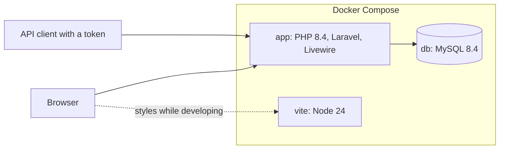

# Destination Explorer

[](https://github.com/nazboyko/bit/actions/workflows/ci.yml)

A catalog of travel destinations with two ways in:

- **A web page** to search, sort and page through the list. The current view lives in the address, so a link opens the same results.
- **A JSON API** for other programs, protected by a read only token.

Built with Laravel 13, Livewire 4, Tailwind 4 and MySQL 8.4. Everything runs in Docker, so the only thing to install is Docker with Compose.

## Quick start

```bash
cp .env.example .env
docker compose build
docker compose run --rm app composer install
docker compose run --rm vite npm ci --ignore-scripts
docker compose run --rm app php artisan key:generate
docker compose up -d
docker compose exec app php artisan migrate --seed
```

Open http://localhost:8000.

Next time, `docker compose up -d` is enough.

## How it fits together



| Service | Address | Role |
| --- | --- | --- |
| `app` | http://localhost:8000 | Serves the page and the API |
| `vite` | http://localhost:5173 | Builds the styles and reloads the page on changes |
| `db` | localhost:3306 | Main database `pe_destinations` and test database `pe_destinations_test` |

Ports are open on localhost only. PHP commands run inside `app`, Node commands inside `vite`.

## Everyday commands

| Task | Command |
| --- | --- |
| Start | `docker compose up -d` |
| Stop | `docker compose down` |
| Stop and delete the database | `docker compose down -v` |
| Run any Artisan command | `docker compose exec app php artisan <command>` |
| Reload the demo data | `docker compose exec app php artisan db:seed` |
| Build the assets for production | `docker compose run --rm vite npm run build` |

The seeder can run again at any time. It updates the demo rows instead of adding copies.

## Checks

One command runs code style, static analysis and the tests, the same way CI does:

```bash
docker compose exec app composer check
```

| Part | Command | Tool |
| --- | --- | --- |
| Code style | `composer lint` | Pint. `composer format` fixes what it finds |
| Static analysis | `composer analyse` | Larastan, level 8 |
| Tests | `composer test` | PHPUnit, against `pe_destinations_test` |

Run them inside `app`, for example `docker compose exec app composer test`. One test file or one test:

```bash
docker compose exec app php artisan test tests/Feature/Api/DestinationIndexTest.php
docker compose exec app php artisan test --filter=test_a_page_past_the_end_shows_the_last_page
```

GitHub Actions runs the same checks on every pull request and push to `main`, and also audits the dependencies and builds the assets. See `.github/workflows/ci.yml`.

## API

### 1. Get a token

```bash
docker compose exec app php artisan api:token you@example.com
```

The token is printed once and can only read destinations. Only its hash is stored.

### 2. Call the API

```bash
curl -H "Authorization: Bearer YOUR_TOKEN" \
  "http://localhost:8000/api/destinations?search=peru&sort=averageDailyBudget&direction=desc"
```

`GET /api/destinations` returns one page of destinations.

| Parameter | Meaning | Default |
| --- | --- | --- |
| `search` | Text to find in name, country, region, cost level and activities. A whole number also matches the daily budget | none |
| `sort` | `name`, `country`, `region`, `costLevel`, `averageDailyBudget` or `annualVisitors` | `name` |
| `direction` | `asc` or `desc` | `asc` |
| `page` | Page number, from 1 to 1000000 | `1` |
| `per_page` | Rows per page, from 1 to 100 | `15` |

### 3. Read the answer

```json
{
    "data": [
        {
            "id": 1,
            "name": "Machu Picchu",
            "country": "Peru",
            "region": "South America",
            "costLevel": "Moderate",
            "activities": ["Hiking & Trekking", "Cultural Tours", "Photography", "Historical Sightseeing"],
            "averageDailyBudget": 150,
            "annualVisitors": 1500000
        }
    ],
    "links": {},
    "meta": {}
}
```

`links` and `meta` carry the paging details, shortened here.

| Status | Meaning |
| --- | --- |
| 200 | Here is the page |
| 401 | The token is missing or not valid |
| 403 | The token is not allowed to read destinations |
| 422 | A parameter is invalid, the body says which one |
| 429 | More than 60 requests a minute from one client |

## When something goes wrong

| What you see | Cause | Fix |
| --- | --- | --- |
| `Vite manifest not found` on the page | The `vite` container is not running | `docker compose logs vite` shows why |
| `sh: vite: not found` in the `vite` log | Node packages are not installed | `docker compose run --rm vite npm ci --ignore-scripts`, then `docker compose up -d` |
| `getaddrinfo for db failed` | A PHP command ran on the host, not in a container | Put `docker compose exec app` in front of it |
| `Connection refused` with `Host: 127.0.0.1` | `.env` points the app at itself | Set `DB_HOST=db` in `.env` |
| `Unknown database 'pe_destinations_test'` | The database volume is older than the script that creates it | `docker compose down -v`, then the last two quick start steps |
| `port is already allocated` | Another project already uses port 8000, 5173 or 3306 | Stop that project first |

## More

- [DISCUSSION.md](DISCUSSION.md) explains what was changed in each section of the assignment, why, and what was left out.
- [PLAN.md](PLAN.md) is the step by step plan the work followed.
